# SWS405 Assignment Report

## Audio and Video Evidence Examination

**Student / Examiner:** Tshewang Dorji
**Unit:** SWS405
**Date of examination:** 5 November 2026
**Case:** Research Lab 2 voice memo and phone video, recorded 3 September 2026
**Note:** All files in this case were synthetic and the case was fictional.

---

# Part A: Assignment Report

## 1. Introduction

### 1.1 Purpose

The purpose of this assignment was to learn how to examine audio and video evidence in a forensically sound way. I followed the demo lab steps for preserving evidence, analysing audio, analysing video, and reporting the results.

### 1.2 Case background

A staff member recorded a voice memo and a phone video at Research Lab 2 on 3 September 2026. Later, two other files were shared. One was a WAV file labelled "Original recording - unedited", which was said to be the original memo. The other was a shorter copy of the video, which was shared in a group chat.

### 1.3 Question to answer

Are the questioned files faithful copies of the original files?

### 1.4 Scope

This examination covered technical analysis only. It looked at what was different between the files. It did not look at who made any changes or why.

## 2. Tools and Method

### 2.1 Tools used

| Tool | Version | Purpose |
|---|---|---|
| sha256sum | System | Checking file integrity with hashes |
| file | System | Finding the real file type |
| ExifTool | 13.55 | Reading metadata |
| FFmpeg / FFprobe | 9.0.2-3 | Reading stream details, converting files, extracting frames and sound |
| SoX_ng | 14.7.1.2 | Spectrograms and sound level measurements |
| MediaInfo | v26.05 | Checking media information |
| VLC | System | Watching video frame by frame |

I recorded the tool versions so that another examiner could repeat my work.

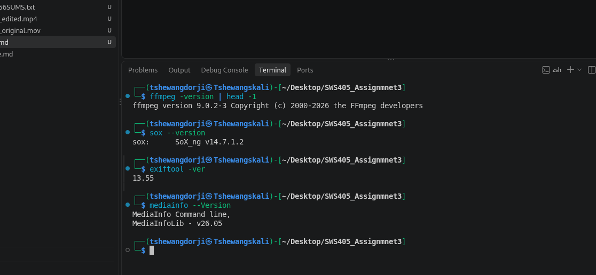

### 2.2 Method

I worked in four parts and used the same order for both audio and video:

1. **Preserve:** I checked hashes, made working copies and identified the real file types.
2. **Audio analysis:** I compared the stream properties, metadata, spectrograms, noise levels, mains hum and content of the audio files.
3. **Video analysis:** I compared the container, metadata, frame types, frame hashes, frame content and soundtrack of the video files.
4. **Report:** I checked the hashes again and wrote down the findings.

I did all analysis on working copies. The original evidence files were never edited.

## 3. Evidence Items

| File | Role | Size |
|---|---|---|
| audio_original.m4a | Known original voice memo from the staff iPhone | 340 KB |
| audio_questioned.wav | Questioned audio, labelled "Original recording - unedited" | 620 KB |
| video_original.mov | Known original phone video | 10.5 MB |
| video_edited.mp4 | Questioned copy shared in a group chat | 558 KB |

The package also contained `README_case.txt` and `SHA256SUMS.txt`.

## 4. Preserving the Evidence

### 4.1 Workspace

I created five folders: `Evidence`, `Working`, `Audio`, `Frames` and `Reports`. I copied the case files into `Evidence`, and I did not change this folder again.

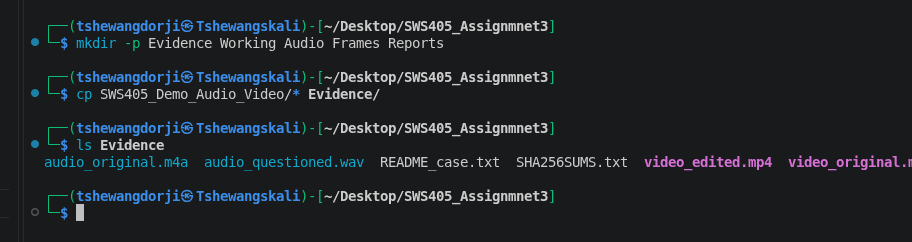

### 4.2 Intake hash check

I checked each file against the hashes in `SHA256SUMS.txt`. All four files showed `OK`. This meant the files were exactly what was handed over. It did not prove that the content was genuine.

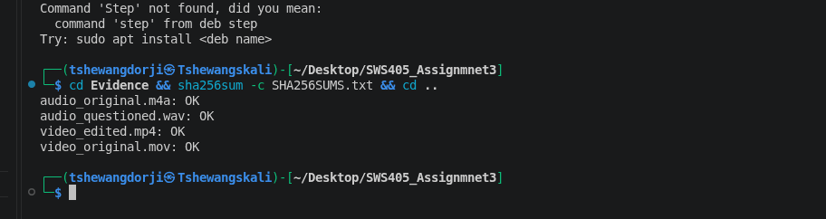

### 4.3 Working copies

I copied the files into `Working` and compared the hashes. The hash of `audio_original.m4a` was the same in `Evidence` and in `Working`:

`c5cbb2da56248b40cb5d9d53ed1eee07ff94dfb4854d148ad16cd24552bd2ce7`

This showed that the copy was identical.

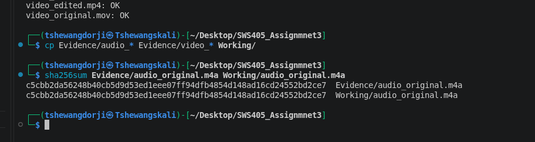

### 4.4 Real file types

I used the `file` command, which reads the file contents and not the extension. Every extension matched its real type. The original video was an Apple QuickTime file, while the edited video was a generic MP4. This was the first sign that the two videos came from different sources.

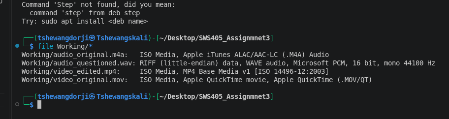

### 4.5 Chain of custody

| Step | Action | Result |
|---|---|---|
| 1 | Evidence received and unpacked into `Evidence` | Four media files and two text files |
| 2 | SHA-256 hashes checked (start of examination) | All four files OK |
| 3 | Working copies made in `Working` | Copy hash matched the original |
| 4 | Analysis done on working copies only | Evidence folder not touched |
| 5 | SHA-256 hashes checked again (end of examination) | All four files OK |

## 5. Audio Examination

The question for this part was: is `audio_questioned.wav` an unedited copy of `audio_original.m4a`?

### 5.1 Listening

I listened to both files first. The original lasted 16.6 seconds and contained the full message. The questioned file lasted 7.0 seconds and ended at "send it tonight". The background noise became louder after the word "ready". Listening only gave leads to test, so I checked each lead with tools.

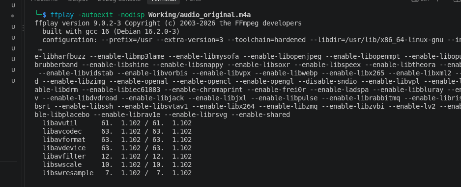

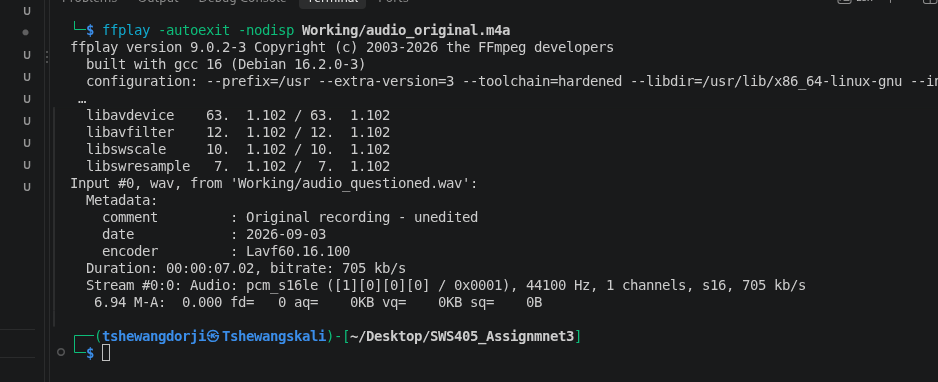

### 5.2 Stream properties

| Property | audio_original.m4a | audio_questioned.wav |
|---|---|---|
| Codec | AAC (compressed) | PCM (uncompressed) |
| Sample rate | 48000 Hz | 44100 Hz |
| Channels | 1 | 1 |
| Duration | 16.617 s | 7.024 s |
| Bit rate | 163 kb/s | 706 kb/s |

An iPhone voice memo is AAC at 48 kHz. A true copy could not have a different sample rate and less than half the length, so the questioned file had been processed.

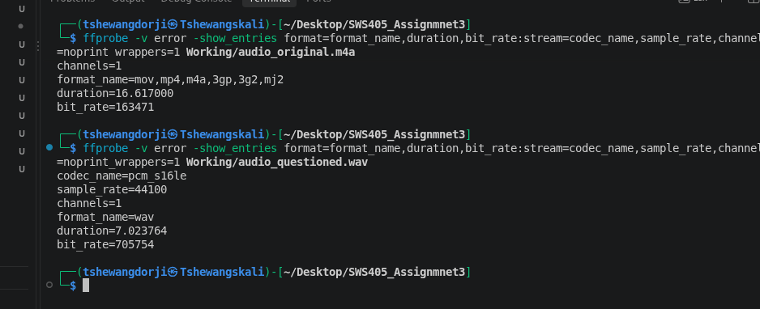

### 5.3 Metadata

The original file showed the handler `Core Media Audio`, the comment "Recorded on iPhone 15 (Voice Memos)" and a creation date of 2026:09:03 10:22:11 (UTC).

The questioned file showed the software `Lavf60.16.100`, the comment "Original recording - unedited" and the date 2026:09:03. Lavf is the FFmpeg library, which is a conversion tool and not a recorder. Anyone can type a comment, so the word "unedited" was only a claim to test. Metadata can also be edited, so I did not use it alone as proof.

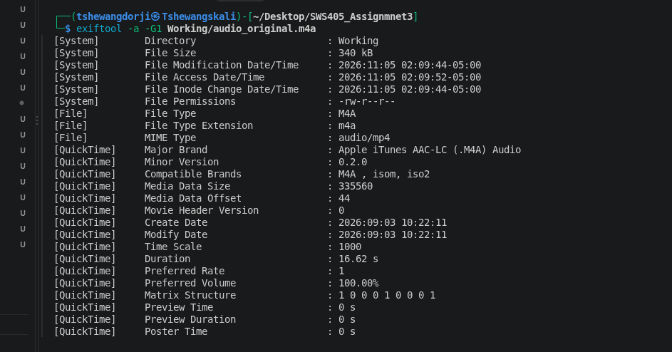

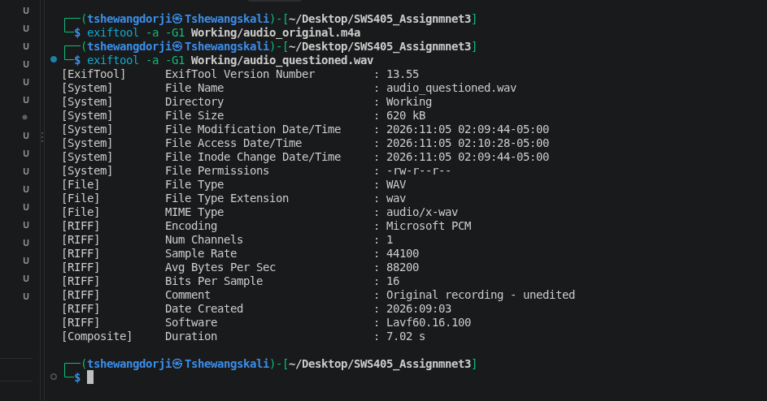

### 5.4 Working copies for analysis

I converted the original to WAV and copied the questioned WAV so that SoX could read them. Converting only changes the container. It cannot restore anything that lossy compression removed.

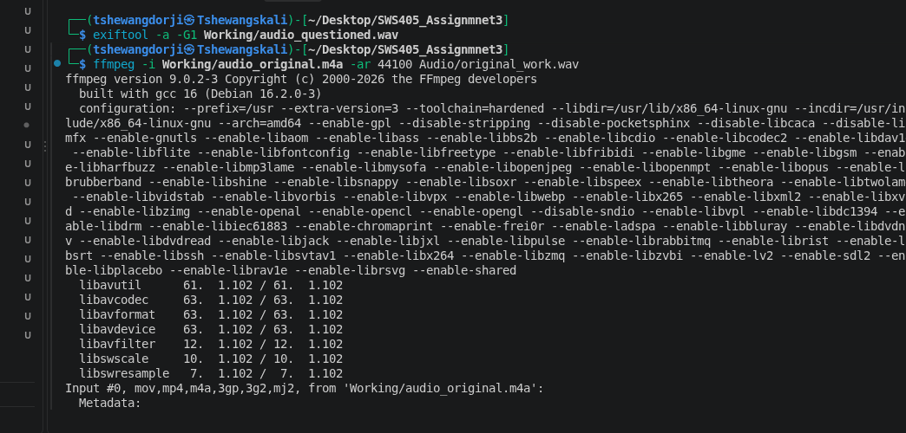

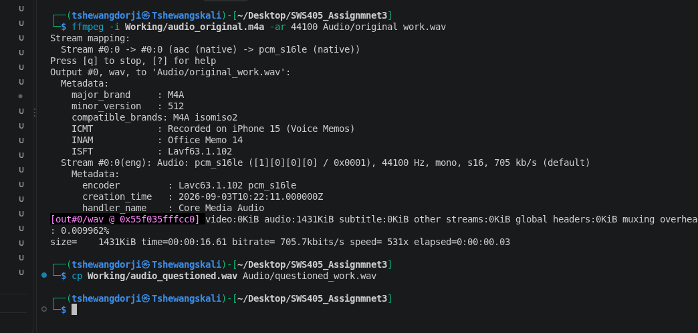

### 5.5 Spectrograms

A spectrogram shows time from left to right, frequency from bottom to top, and loudness as colour. I made one for each file and found two things in the questioned file:

1. **A join at 4.44 s.** The background suddenly became brighter at every frequency in a straight vertical line. A real room does not change this fast, but a join between two recordings does. The original had an even background for the full 16.6 seconds.
2. **A ceiling at 16 kHz.** The original had sound up to about 22 kHz, but the questioned file had nothing above 16 kHz. This flat cut-off is typical of an MP3 encoder, so the "original WAV" was most likely converted from an MP3.

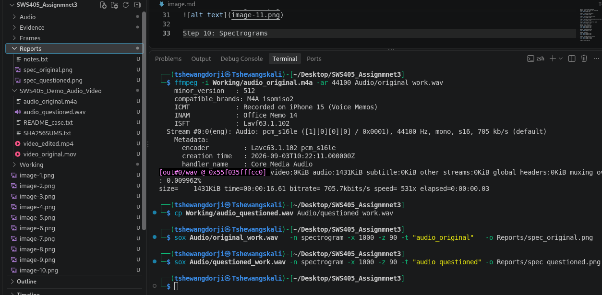

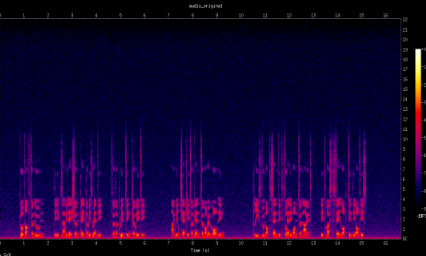

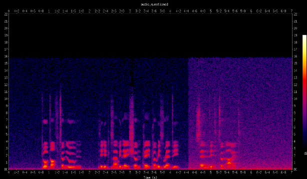

### 5.6 Background noise level

I measured the background noise in a quiet pause before the join (0.1 to 0.7 s) and after the join (6.2 to 6.9 s). I converted the values to dBFS using `20 x log10(RMS)`.

| Pause measured | Original RMS | Questioned RMS |
|---|---|---|
| 0.1 to 0.7 s | 0.0036 (about -49 dBFS) | 0.0034 (about -49 dBFS) |
| 6.2 to 6.9 s | 0.0037 (about -49 dBFS) | 0.0111 (about -39 dBFS) |

The original stayed at the same level. The questioned file became 10 dB louder after the join. This suggested that the second part was recorded in a noisier place.

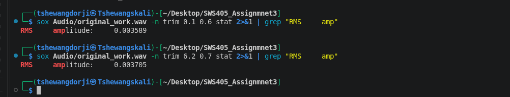

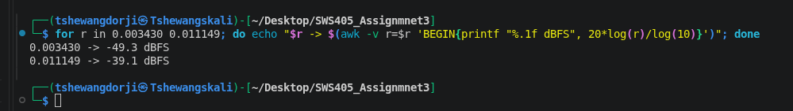

### 5.7 Mains hum (ENF) test

Bhutan's power grid runs at 50 Hz, so indoor recordings usually carry a faint 50 Hz hum and harmonics at 100 Hz and 150 Hz. I zoomed into the 0 to 500 Hz range of the questioned file. The 50 Hz line was faint until 4.44 s and then became much brighter. One continuous recording would have kept the same hum, so the two parts seemed to come from different electrical environments.

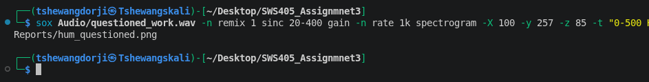

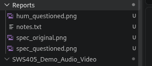

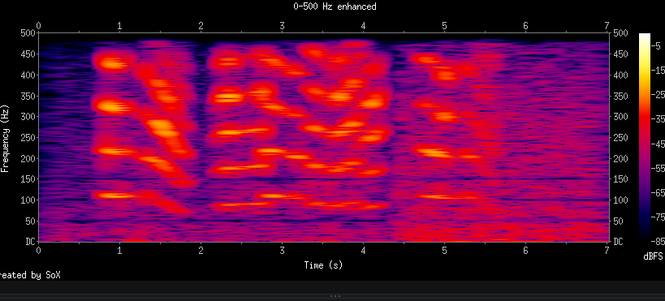

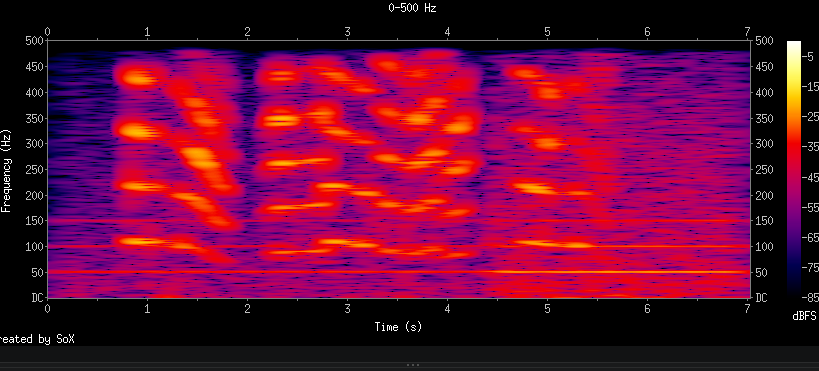

### 5.8 Content comparison

I compared the words in both files. The first 4.4 seconds of the questioned file matched the start of the original, in the same voice. The phrase "send it tonight" did not appear in the original. The nearest phrase in the original was "Please do not send it to anyone tonight". The words "for the printing committee" were missing from the questioned file. At 4.44 s there was no natural breath or pause, only a jump in the background level.

### 5.9 Enhancement on a copy

I removed the hum from a copy of the questioned file with narrow notch filters at 50, 100 and 150 Hz. The new spectrogram showed that the hum lines were gone and the speech was not changed. I kept the original file and recorded the exact command in my log. An enhanced copy makes speech easier to hear, but it is never the evidence itself.

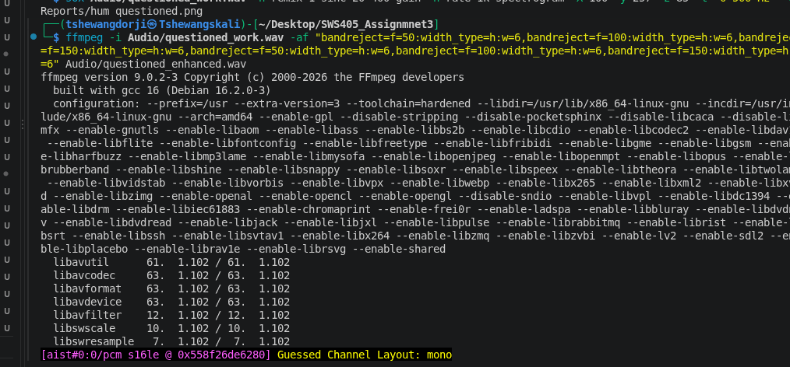

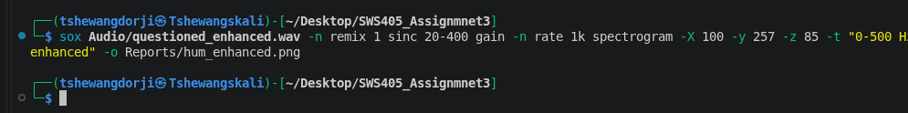

### 5.10 Audio summary

| Test | Result |
|---|---|
| Metadata | Made by FFmpeg (Lavf60.16.100), not by a recorder |
| Sample rate and length | 44100 Hz and 7.0 s, against 48000 Hz and 16.6 s |
| Frequency ceiling | No content above 16 kHz, consistent with MP3 origin |
| Spectrogram | Sudden join at 4.44 s |
| Noise level | -49 dBFS changed to -39 dBFS at the join |
| Mains hum | 50 Hz hum became much stronger at 4.44 s |
| Content | "send it tonight" not found in the original |

## 6. Video Examination

The question for this part was: is `video_edited.mp4` a faithful copy of `video_original.mov`?

### 6.1 Watching the videos

I watched both videos in VLC and stepped through the frames near the door. In the original, a person swiped a card and walked into the lab between about 9 and 14 seconds. In the edited copy, this part was missing and the video jumped ahead.

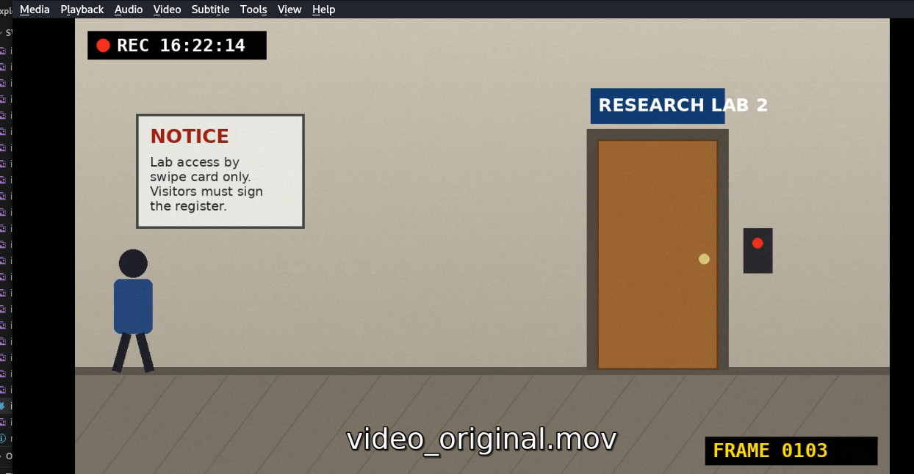

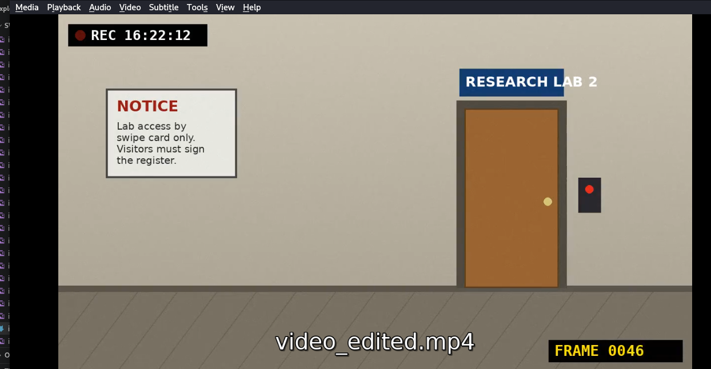

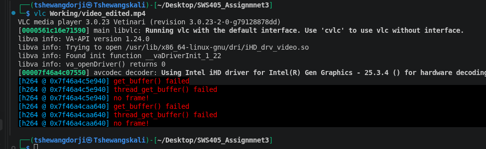

### 6.2 Container, codec and stream properties

A video file is a container (MOV or MP4) that holds streams made with codecs (H.264 for video and AAC for audio). I used `ffprobe` to compare the two files and saved the full reports in the `Reports` folder.

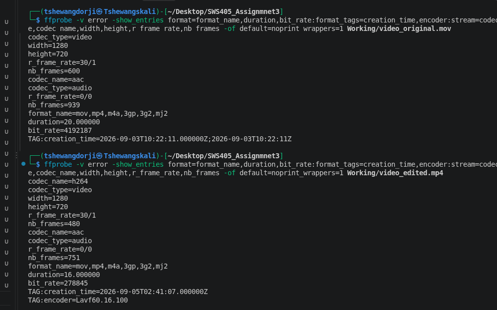

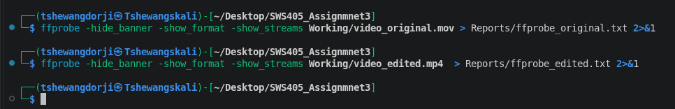

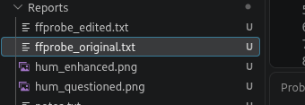

### 6.3 Device, GPS and dates

| Property | video_original.mov | video_edited.mp4 |
|---|---|---|
| Container | QuickTime MOV | MP4 |
| Video and audio codec | H.264 / AAC | H.264 / AAC |
| Resolution and frame rate | 1280 x 720, 30 fps | 1280 x 720, 30 fps |
| Duration | 20.0 s | 16.0 s |
| Number of video frames | 600 | 480 |
| Created (UTC) | 2026-09-03 10:22:11 | 2026-09-05 02:41:07 |
| Device | Apple iPhone 15 | None |
| GPS | Thimphu | None |
| Encoder | Apple H.264 | Lavf60.16.100 / libx264 |

From this table I found that:

- The edited video was created two days after the original.
- 600 minus 480 gives 120 missing frames. At 30 frames per second, this is 4.0 seconds.
- Lavf and libx264 are FFmpeg tools. Missing device and GPS data is typical of re-encoding. On its own, missing metadata proves nothing, but here it agreed with the other evidence.

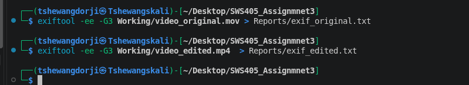

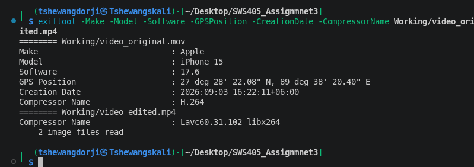

### 6.4 Frame types and GOP

An I-frame is a complete picture. P-frames and B-frames only store changes. A camera normally writes an I-frame at regular intervals. The original had 20 I-frames, one every second. The edited video had only 2. This showed that the video was re-encoded and not just copied. It did not show where the cut was.

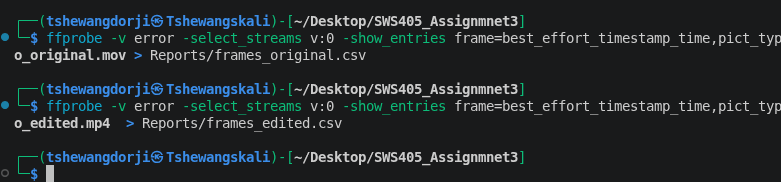

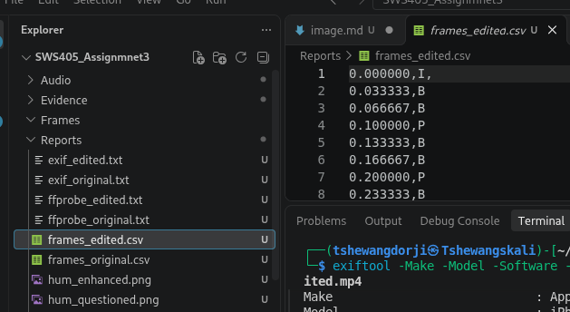

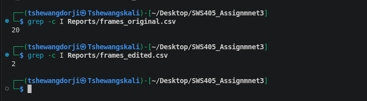

### 6.5 Frame hashes

I made a hash of every decoded frame in both videos and counted how many frames were identical. The result was 0. None of the 480 frames in the edited video matched any of the 600 original frames. This meant that every frame was re-compressed. A simple cut without re-encoding would have left matching frames.

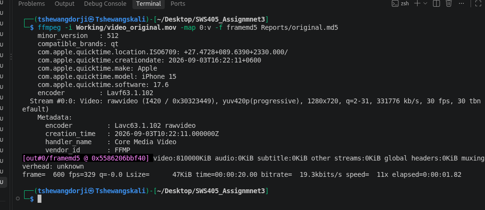

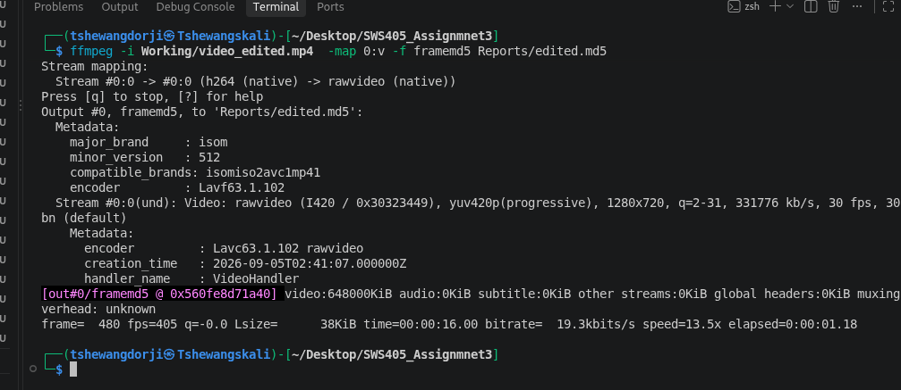

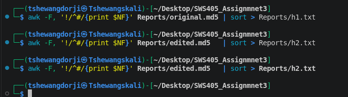

### 6.6 Finding the cut

I extracted frames from the edited video and placed frames 270 and 271 side by side. The on-screen counter jumped from FRAME 0270 to FRAME 0391, and the clock jumped from 16:22:19 to 16:22:24. On the left, the person stood at the door. On the right, the door was already open and nobody was there. In the original video, frames 271 to 390 showed the person swiping the card and walking into the lab.

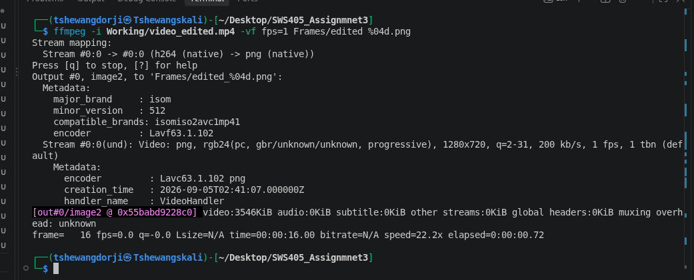

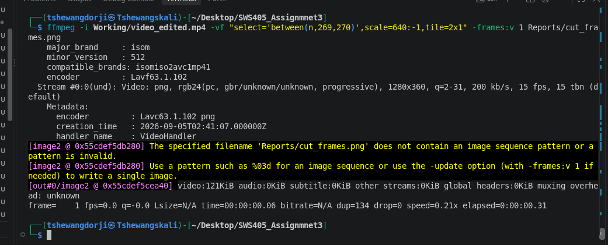

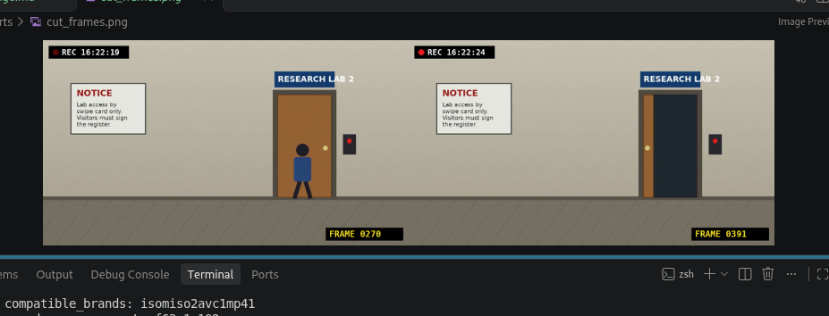

### 6.7 Soundtrack and event analysis

I extracted the sound from both videos and made spectrograms.

- **Original:** speech from 0.4 to 5 s, footsteps every 0.5 s, two card-reader beeps at about 1.8 kHz at 10.2 s and 10.45 s, the door at 10.6 s, more footsteps from 11.5 to 12.5 s, and the door closing at 14.0 s.
- **Edited:** the footsteps stopped at about 9 s, the beeps and the door opening were gone, and the door closing appeared at 10.0 s (14.0 minus 4.0).

The sound confirmed the same 4-second cut and showed which events were removed.

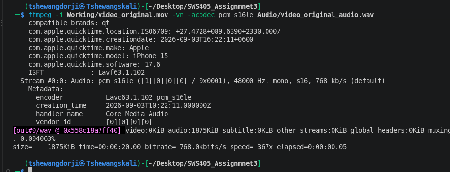

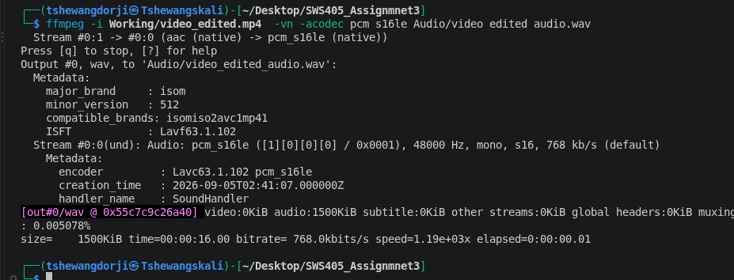

### 6.8 Video summary

| Test | Result |
|---|---|
| Frame count | 480 frames against 600 |
| Duration | 16.0 s against 20.0 s |
| Metadata | Device and GPS removed, created two days later, encoder is FFmpeg |
| Frame types | 2 I-frames against 20 |
| Frame hashes | 0 of 480 frames identical |
| Frame content | Counter jumped from 0270 to 0391 |
| Soundtrack | Card beeps and footsteps removed |

## 7. Closing the Case

At the end of the examination, I checked the hashes of all four evidence files again. All four showed `OK`. This showed that my analysis did not change the evidence.

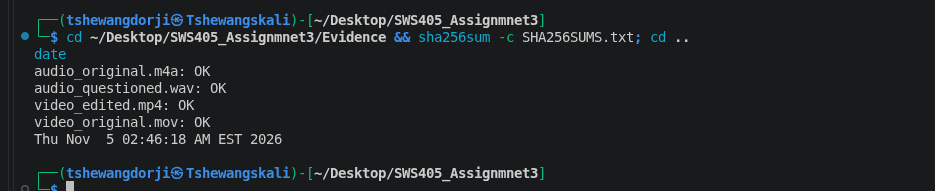

## 8. Limitations

- Metadata can be edited, so I did not use it alone as proof.
- This examination showed what was different between the files. It did not show who made the edits or why. These questions were outside the scope of this technical examination.
- The enhanced audio was made only to make the hum easier to see. It was a working copy and was not used as evidence.

## 9. Conclusion

Neither questioned file was a faithful copy of its original. The audio file showed signs of editing at 4.44 s, and the video file had 4.0 seconds removed and was re-encoded. The hashes showed that the evidence stayed unchanged during the examination.

---

# Part B: Investigation Report

## VIDEO AND AUDIO EXAMINATION: SUMMARY OF FINDINGS

**Examiner:** Tshewang Dorji
**Date:** 5 November 2026
**Tools:** sha256sum, file, ExifTool 13.55, FFmpeg / FFprobe 9.0.2, SoX_ng 14.7.1.2, MediaInfo v26.05, VLC

### 1. Integrity

All four exhibits matched their intake SHA-256 hashes at the start and at the end of the examination. All analysis was done on working copies.

### 2. audio_questioned.wav compared with audio_original.m4a

- a. The metadata recorded the software as Lavf60.16.100 (FFmpeg) and not a recording device.
- b. The sample rate was 44100 Hz against 48000 Hz, and the duration was 7.02 s against 16.62 s.
- c. There was no content above 16 kHz, which is consistent with earlier MP3 encoding. The file was therefore not an original recording, even though its comment said "Original recording - unedited".
- d. At 4.44 s the background noise rose from about -49 dBFS to -39 dBFS and the 50 Hz mains hum increased suddenly. This is consistent with a join between two recordings made in different acoustic environments.
- e. The first 4.4 s corresponded to the start of audio_original.m4a. The phrase "send it tonight" was not found in audio_original.m4a.

**Finding:** Indicators of editing were found at 4.44 s.

### 3. video_edited.mp4 compared with video_original.mov

- a. The edited video had 480 frames (16.0 s) and the original had 600 frames (20.0 s). The resolution and frame rate were the same.
- b. The edited video was created on 2026-09-05 with the encoder Lavf / libx264, and its device and GPS metadata were missing.
- c. It had 2 I-frames against 20, and 0 of its 480 frames matched the original frames. This indicates full re-encoding.
- d. Between frames 270 and 271 the on-screen counter jumped from 0270 to 0391 and the clock from 16:22:19 to 16:22:24. The original frames 271 to 390 showed a person using the card reader and entering Research Lab 2.
- e. The card-reader beeps (10.2 s and 10.45 s) and footsteps in the original soundtrack were absent from the edited soundtrack.

**Finding:** 120 frames (4.0 s) were removed and the video was re-encoded.

### 4. Timeline of the recorded events

| Time (UTC) | Event |
|---|---|
| 2026-09-03 10:22:11 | Original audio and video recorded on the iPhone (16:22:11 Bhutan time) |
| 2026-09-05 02:41:07 | Edited video file created |
| 2026-11-05 | Examination carried out |

### 5. Limitations

Metadata can be altered. Who made the edits, and why, is outside the scope of this technical examination. The wording "indicators of editing" and "consistent with" was used on purpose. If nothing had been found, the correct sentence would have been "No evidence of editing was detected", and not "proved genuine".

---
